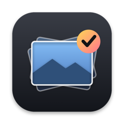
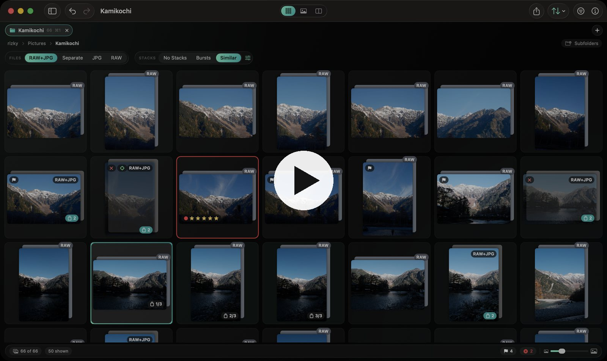
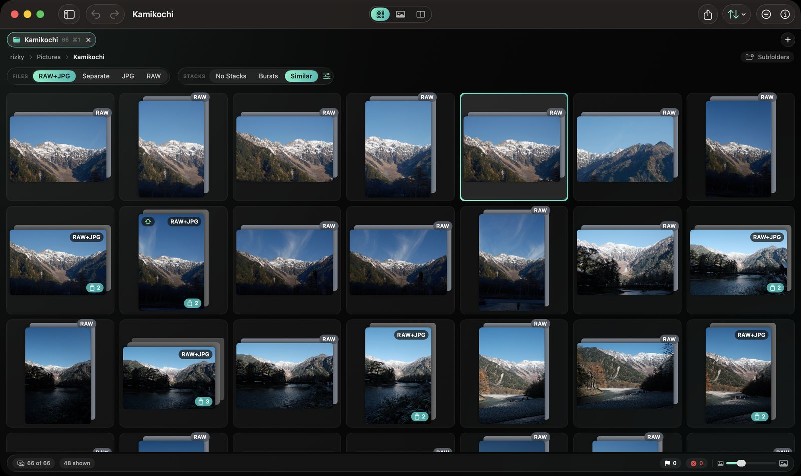
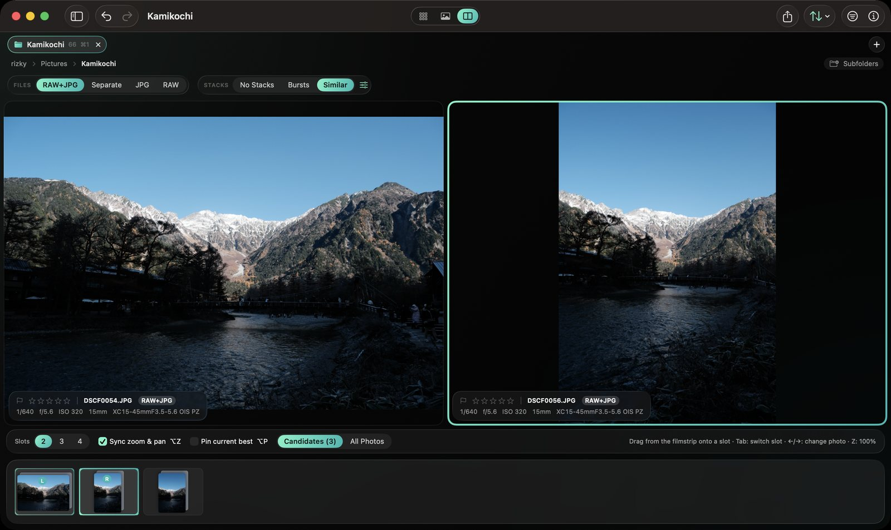
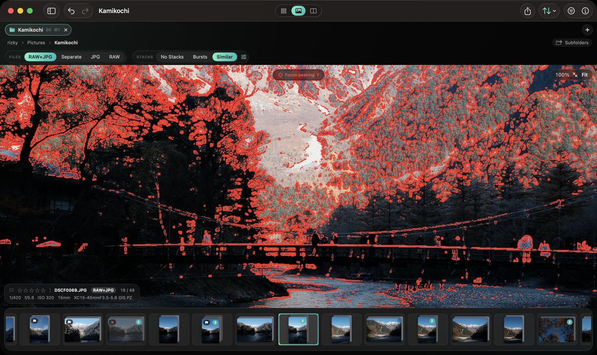
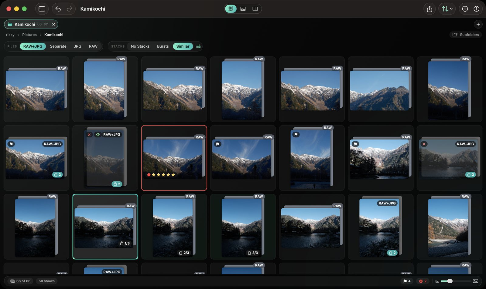
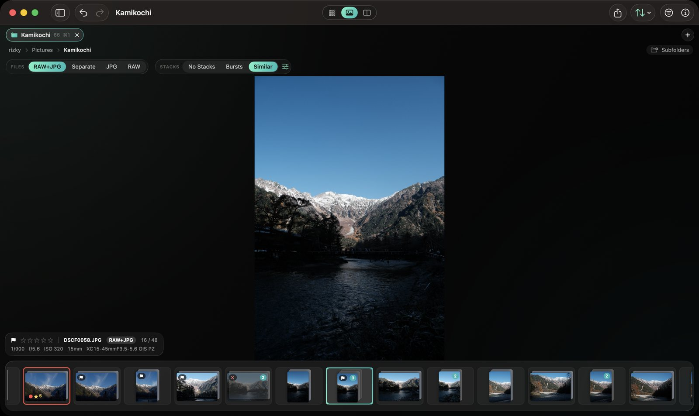
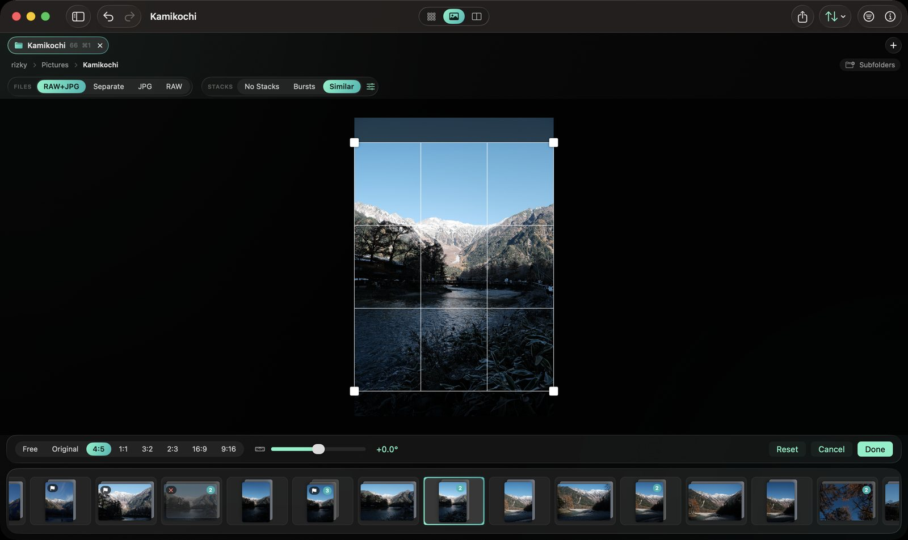
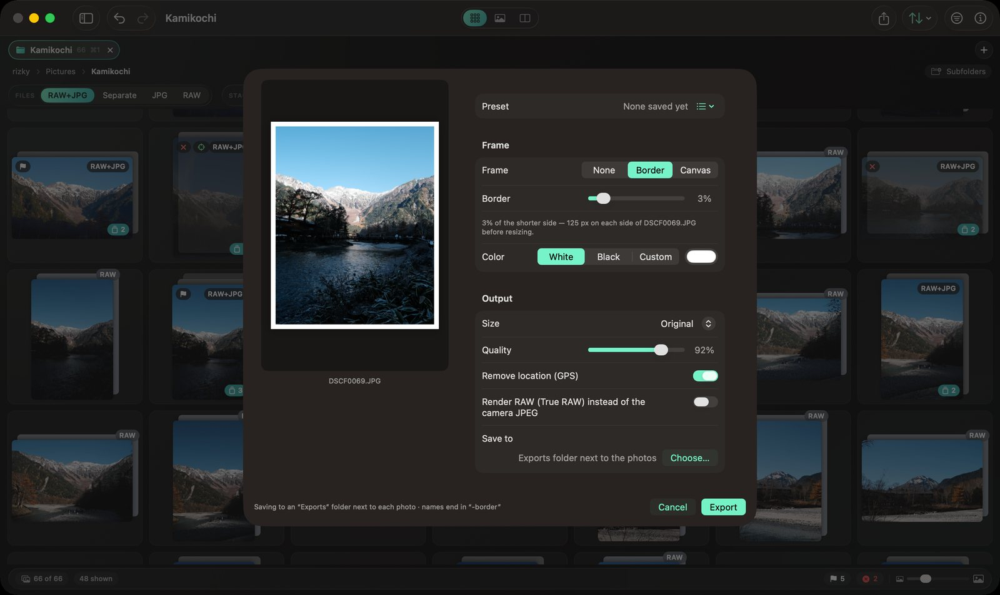

<p align="center"></p>

<h1 align="center">Pickture</h1>

<p align="center"><b>Pick the keepers from every shoot — fast, right from the keyboard.</b><br>
A native macOS photo culling app for RAW + JPEG shooters.</p>

<p align="center">
  <a href="https://github.com/Rzkykhrllh/pickture/releases/latest"><b>⬇︎ Download for macOS</b></a> ·
  <a href="https://github.com/Rzkykhrllh/pickture/releases/download/v0.1.1/pickture-demo.mp4"><b>▶︎ Watch the 1-minute demo</b></a>
</p>

<p align="center"><a href="https://github.com/Rzkykhrllh/pickture/releases/download/v0.1.1/pickture-demo.mp4"></a></p>

---

Pickture is for the step between the memory card and your editor: go through a shoot, keep the best frames,
throw out the rest, and hand the keepers to Lightroom (or anywhere else). It is not a catalog and not an editor —
it works directly on your folders and never changes your pixels.

## Features

**Cull fast**
- Pick / reject / unflag, 0–5 stars, color labels and notes — one key each, and ⇧ to mark and move on (Caps Lock: always advance).
- Grid, Loupe and Compare (2–4 photos side by side, zoom and pan in sync).
- Select a block (⇧ + arrows or ⇧-click, in the grid and the loupe's filmstrip) and mark it in one go.
- Filters (flag, rating, label, file type, camera, lens, ISO, aperture, date…) and sorting.

<p align="center"></p>

**RAW + JPEG, done right**
- Show a RAW and its JPEG as one photo (marks go to both), separately, or only one kind.
- *True RAW* rendering from the sensor data, or the camera's own preview (film simulations and all).

**Find the best frame**
- Bursts and *similar* photos stack together automatically (on-device Vision; a strict ↔ loose slider).
- Focus peaking, highlight / shadow clipping, zoom straight to the eyes, face or animal, and a hint for the sharpest frame of a stack.

<table>
  <tr>
    <td width="50%"><br><sub><b>Compare</b> — two to four frames side by side, zoom and pan in sync</sub></td>
    <td width="50%"><br><sub><b>Focus peaking</b> at 100% — see what is actually sharp</sub></td>
  </tr>
  <tr>
    <td width="50%"><br><sub><b>Stacks</b> — bursts and similar shots grouped, S to expand</sub></td>
    <td width="50%"><br><sub><b>Loupe</b> — one photo, filmstrip and shooting info</sub></td>
  </tr>
</table>

**Crop & export**
- Non-destructive crop and straighten with ratios (4:5, 1:1, 9:16, 16:9, custom…).
- Export many photos at once: white border (% of the photo), or a fixed-ratio canvas such as 4:5, any color, sized for posting (e.g. 1080 px wide), GPS removed. Save your own export presets.

<table>
  <tr>
    <td width="50%"><br><sub><b>Crop</b> — 4:5 for a post, saved to XMP so Lightroom shows it too</sub></td>
    <td width="50%"><br><sub><b>Export</b> — white border or a fixed-ratio canvas, for many photos at once</sub></td>
  </tr>
</table>

**Hand off**
- Import into Lightroom with one shortcut, *Open With* any photo app, Share (AirDrop, Messages, Mail…), ⌘C to paste files anywhere.
- Rename with templates, move / copy, move rejects to the Trash — all undoable (⌘Z, Operation History).

**Feels like a Mac app**
- Finder-like sidebar, browser-like tabs, light on resources even with tens of thousands of photos.
- Every action has a shortcut — and every single-key shortcut can be changed (Settings ▸ Shortcuts, with a left-hand preset).
- Themes: accent colors and backgrounds.

**Your files stay yours**
- Marks are written into the photos' XMP (embedded in JPEG / HEIC / TIFF, `.xmp` sidecars for RAW), so Lightroom and other tools read the ratings, labels and crops.
- Writes are merge-only and atomic; pixels are never re-encoded. Nothing is deleted permanently — Trash and undo only.
- Everything runs on your Mac: no account, no network, no tracking.

## Install

1. Download the latest **Pickture-x.y.z.dmg** from [Releases](https://github.com/Rzkykhrllh/pickture/releases).
2. Open it and drag **Pickture** to **Applications**.
3. The app is not notarized yet, so the first launch needs one extra step: right-click Pickture ▸ **Open** ▸ **Open**
   (or System Settings ▸ Privacy & Security ▸ **Open Anyway**).

Requires **macOS 14 Sonoma or later**, Apple silicon or Intel.

On first launch a short guide explains the basics. Press **?** at any time for every shortcut.

## Keyboard (defaults)

| | |
|---|---|
| `P` / `X` / `U` | Pick · Reject · Unflag (⇧ = and next) |
| `0`–`5`, `6`–`9`, `⌥9`, `⌥0` | Rating · Red / Yellow / Green / Blue · Purple · clear label |
| `←` `→` `↑` `↓`, `⌥←` `⌥→` | Move · next / previous unflagged (⇧ extends the selection) |
| `G` / `E` / `C` | Grid · Loupe · Compare |
| `Z` / Space, `⌘0` | 100% zoom · zoom to fit |
| `S`, `B` | Expand / collapse a stack · sharpest in stack |
| `F` / `J` / `Y` | Focus peaking · clipping · zoom to eyes / face |
| `K`, `⇧⌘E` | Crop / straighten · export |
| `⌫`, `⇧⌘⌫` | Move to Trash · all rejects to the Trash |
| `⌃⌘L`, `⌘C` | Import into Lightroom · copy the files |
| `⌘Z` / `⇧⌘Z` | Undo / redo |

Single-key shortcuts can be changed in Settings ▸ Shortcuts.

---

## Building from source

```bash
brew install xcodegen          # project.yml → Pickture.xcodeproj
xcodegen generate
open Pickture.xcodeproj        # ⌘R to run, ⌘U to test
```

Command line:

```bash
scripts/install.sh             # Release build → /Applications/Pickture.app
scripts/make-dmg.sh            # → dist/Pickture-<version>-<build>.dmg
cd Packages/CullerKit && swift test
```

### Stable signing (so permissions survive rebuilds)

By default the app is signed ad-hoc: every build is a new identity to macOS, so folder access and the
“access data from other apps” prompt come back after each build. With a free Apple Development certificate
the identity stays the same:

1. Xcode ▸ Settings ▸ Accounts ▸ **+** ▸ Apple ID (a free account is enough).
2. Select the account ▸ **Manage Certificates…** ▸ **+** ▸ **Apple Development**.
3. `./scripts/setup-signing.sh` — writes the git-ignored `Config/Signing.local.xcconfig` and regenerates the project.

Grant folder access once more after the switch; it then persists across builds.
For Mac App Store / Developer ID distribution use the same file with the matching identity.

## Project layout

```
Pickture/                    App target
  App/                       entry point, menus, keyboard routing
  Model/                     FolderSession (items, stacks, display, marking, undo, file ops, crop, export)
  Features/                  Grid, Loupe, Compare, Edit (crop, export), Filter, Info, Sidebar, Settings…
  Shared/                    key map + custom shortcuts, theme, controls
Packages/CullerKit/          Core library, unit-tested (`swift test`)
  Model/                     FileRef / ItemFiles, PhotoMetadata, CropSpec, ExifInfo, FilterState, SortOrder
  Services/                  FolderScanner, StackBuilder, ExifReader, XMPCodec, MetadataStore, IndexStore (GRDB),
                             ImageDecoder / ImagePipeline, PhotoExporter, FocusAnalysis, Similarity,
                             RenameTemplate, FileOperations, OperationLog, Bookmarks, FolderWatcher
design/icons/                App icon concepts and the scripts that draw them
docs/SPEC.md                 Original specification
```

## How marks are stored

| Field | Where |
|---|---|
| Rating | `xmp:Rating` |
| Color label | `xmp:Label` (`Red`, `Yellow`, `Green`, `Blue`, `Purple`) |
| Flag | `culler:Flag` = `pick` / `reject` |
| Note | `culler:Note` |
| Crop | `culler:Crop`, plus Camera Raw `crs:HasCrop` / `crs:Crop*` (in the file's stored orientation) so Lightroom shows it |

- JPEG / HEIC / TIFF: embedded XMP, written with `CGImageDestinationCopyImageSource`, so pixels are never re-encoded.
- RAW (incl. **DNG**) and PNG: `<basename>.xmp` sidecar. ImageIO cannot write DNG (it is not in
  `CGImageDestinationCopyTypeIdentifiers()`), which settles spec open item §17.
- RAW+JPEG pairs: the sidecar and the JPEG's embedded XMP are kept in sync.
- Every write is merge-only (other tools' XMP is preserved), atomic (temp file + replace) and debounced
  in a background queue. A compact JSON backup goes into the `com.byairu.photoculler.meta` xattr; a
  missing RAW sidecar is regenerated from it when the folder is reopened.
- Two ImageIO quirks are handled: `kCFNull` tag removal is ignored for HEIC/TIFF (clears are written as
  empty values instead), and ImageIO cannot parse an XMP packet with no properties (written by hand
  and recognized with an XML parser).

## Performance (Apple M2, 820 RAF + 820 JPG, 54 GB)

Measured with the read-only benchmark (`swift run -c release culler-bench <folder>` in `Packages/CullerKit`):

| | |
|---|---|
| Scan 1,640 files → 820 items | 0.1 s |
| EXIF + XMP index (first open; cached afterwards) | 0.7–1.4 s |
| RAW+JPG grid: placeholders / first screen sharp / all 820 | 0.13 s / 1.4 s / 12 s |
| RAW only, camera preview: first screen / all | 0.5 s / 11 s |
| RAW only, True RAW: camera preview shown / first screen True RAW / all | 0.3 s / 11 s / ~3.5 min (background, disk-cached) |
| Loupe preview 2560 px: JPG / RAW camera / True RAW | 170 / 175 / 300 ms (next 3 prefetched) |
| 100% zoom: RAW / JPG | 50 / 330 ms |

The first RAW a process touches costs ≈5 s (ImageIO RAW support) and the first Core Image RAW render ≈7 s;
both are warmed up in the background as soon as a folder opens, and RAW+JPG thumbnails use the JPEG until then.
Pairs take their thumbnail from the RAW's embedded preview (same camera look, ~6× faster than decoding a 26 MP JPEG),
with the 1 ms embedded EXIF thumbnail shown first.

Real-camera-file tests (copied to a temp folder, never modified in place):

```bash
CULLER_REAL_RAW_DIR=/path/to/copy/of/a/shoot swift test --filter RealCameraFileTests
```

Use a copy outside protected folders (Documents, Desktop…): the `xctest` helper has no permission to read them.

Similar-photo grouping on a folder from the command line: `swift run -c release culler-similar <folder>` —
prints the groups found at several thresholds (useful for tuning).

## Development aids (Debug builds only)

Debug builds accept test flags, e.g.

```bash
build/DD/Build/Products/Debug/Pickture.app/Contents/MacOS/Pickture \
  -openFolder ~/Library/Containers/com.byairu.photoculler/Data/Documents/TestShoot -selfTest
log stream --predicate 'subsystem == "com.byairu.photoculler"' --level info
```

`-demo` runs a scripted tour (on a *copy* of a shoot: it writes marks and a crop) and saves the README screenshots
and `pickture-demo.mp4` to `Documents/Demo` in the container, then quits.

Other flags: `-uiSnapshots`, `-scrollTest`, `-modeTest`, `-editTest`, `-shortcutTest`, `-trashTest`, `-hangWatch`, `-subfolders`.
Use folders inside the app container: `Data/Pictures` etc. there are symlinks to your real folders.

## Credits

Made by [Rizky Khairullah](https://dev.byairu.com). Uses [GRDB.swift](https://github.com/groue/GRDB.swift) (MIT).
